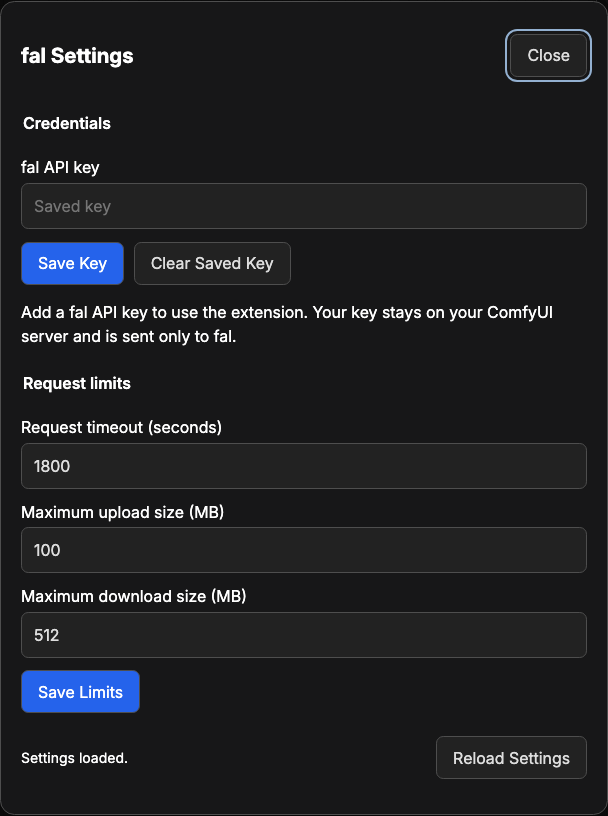

# Advanced Guide to Running fal Models in ComfyUI

## Contents

- [What each node sends](#what-each-node-sends)
- [Keys and access](#keys-and-access)
- [Settings](#settings)
- [Models](#models)
- [Files and uploads](#files-and-uploads)
- [Caching and reruns](#caching-and-reruns)
- [Recover a request](#recover-a-request)
- [Limits](#limits)
- [When a node stops](#when-a-node-stops)
- [Use from another extension](#use-from-another-extension)
- [Update or remove](#update-or-remove)
- [Development](#development)
- [Package and publish](#package-and-publish)
- [Troubleshooting](#troubleshooting)

## What each node sends

**Image: Generate**, **Video: Generate**, **Audio: Generate**, **Text:
Generate**, and **3D: Generate** are the paid nodes. Each one first reads the
model from the public fal list of models. That read is free, and the node makes
it once per model while ComfyUI runs. Then the paid node takes these steps:

1. It uploads your images as lossless WebP, your masks as PNG, your audio as
   WAV, and your video as MP4 to fal storage, with each request.
2. It sends `prompt`, the settings in `arguments`, and the files from **File:
   Add** to the fal queue in one request, under the fal names.
3. It records the request as soon as fal accepts it, and waits until fal says
   that the request has finished.
4. It downloads the output files and returns them. It also returns the fal link
   of each file in `files`, and the whole fal result as JSON in `result`.

**Text: Generate** also returns the model's answer in `text`. It takes the
answer from the result field that holds it, and prefers a field named like
`output` or `text`.

The other nodes:

- **File: Add** names the model input a file goes to and adds the file: a
  link, an image, a mask, audio, video, or the files of another fal node. It
  sends nothing; the paid node uploads what it holds.
- **Request: Download** reads one recorded request's status and result, and
  downloads its files. Status reads and downloads are free.
- **Request Options** adds request options to the request of each connected
  paid node. The options are queue priority, a start timeout, retries and
  fallbacks on fal, how long output files last, and whether fal keeps the
  request history.
- **Model: Info** reads one model from fal's list of models and returns every
  setting it takes and what it makes, as JSON. It is free and needs no key.

Every request goes out once. The nodes download the files that fal makes
without sending the key.

## Keys and access

Open the ComfyUI menu, select **Extensions**, then **fal**, then **fal
Settings**, and save the key there. A fal key has two parts,
`key_id:key_secret`; paste the whole key. The extension stores the key in the
private folder, and the first request that uses the key checks it. `FAL_KEY`,
set where ComfyUI starts, takes precedence. The key goes only to fal.

You can change the key and settings only over a direct local connection to the
ComfyUI server. For remote access, a reverse proxy, or multi-user mode, set
`FAL_KEY` instead.

The private folder is:

| System  | Folder                                        |
| ------- | --------------------------------------------- |
| macOS   | `~/Library/Application Support/FalComfyUI`    |
| Linux   | `${XDG_STATE_HOME:-~/.local/state}/fal-comfy` |
| Windows | `%LOCALAPPDATA%\FalComfyUI`                   |

To use another folder, set `FAL_COMFY_STATE_DIRECTORY` to an absolute path
outside the extension and ComfyUI's folders. The extension writes the files
unencrypted, with owner-only permissions.

## Settings

Change these in **fal Settings**. New requests use the saved values.



| Setting                        | Default | Range      | What it limits                                                                                  |
| ------------------------------ | ------- | ---------- | ----------------------------------------------------------------------------------------------- |
| **Request timeout (seconds)**  | 1800    | 10 to 3600 | How long one request may take, from sending to the last download, time in fal's queue included. |
| **Maximum upload size (MB)**   | 100     | 1 to 100   | Each image, mask, audio, or video uploaded to fal.                                              |
| **Maximum download size (MB)** | 512     | 16 to 4096 | The largest result or output file accepted.                                                     |

## Models

Each paid node runs any fal model that makes its kind of output. Type the
model ID in `model`: the model's name on fal, such as
`alibaba/wan-3.0/reference-to-video`. The default is the model each node
starts with:

| Node            | Runs models that make | Default model                                |
| --------------- | --------------------- | -------------------------------------------- |
| Image: Generate | Images                | `fal-ai/flux-2/klein/4b`                     |
| Video: Generate | Video                 | `fal-ai/ltx-2.3-22b/distilled/text-to-video` |
| Audio: Generate | Audio                 | `fal-ai/minimax/speech-2.8-turbo`            |
| Text: Generate  | Text                  | `fal-ai/elevenlabs/speech-to-text/scribe-v2` |
| 3D: Generate    | 3D models             | `fal-ai/trellis-2`                           |

The node for a model depends on what the model returns, not on its category
on fal. An upscaler, a background remover, and a lip-sync model therefore each
run in the node for what they make. Model-training models and realtime models
are not run.

Before fal bills anything, the node reads the model from the public list of
models on fal. The read gives the settings and the outputs of the model. It
reads each model once while ComfyUI runs, free and without needing the key,
and waits when fal asks it to read more slowly. The checks it makes are in
[When a node stops](#when-a-node-stops); fal itself checks every value, and
its refusal names the setting and gives the reason.

The named settings are the fields most models of a kind share:

| Node            | Named settings                                                                                                   |
| --------------- | ---------------------------------------------------------------------------------------------------------------- |
| Image: Generate | `aspect_ratio`, `resolution`, `num_images`, `output_format`, `guidance_scale`, `num_inference_steps`, and `seed` |
| Video: Generate | `duration`, `resolution`, `aspect_ratio`, `generate_audio`, and `seed`                                           |
| Audio: Generate | `output_format` and `seed`, with `voice` and `text` as text inputs                                               |

Each named setting at `default` sends nothing. At `custom`, it goes under its
own name, and only a model with a field of that name takes it. A number goes
as text to a field that takes only text, such as a duration fal lists as
`"5"`. A model that names a setting another way, such as `image_size`, takes it
in `arguments`.

`arguments` is a JSON object of the model's other settings under fal's names,
such as `{"resolution": "480p", "duration": 5}`. A value goes as written: write
`"5"` where fal lists the text `"5"`. Settings you leave out keep their
defaults on fal. Some defaults are the most expensive choice: Wan 3.0, for
example, defaults to 1080p. **Model: Info** lists every setting, its choices,
and its default.

## Files and uploads

Give a model a file with **File: Add**. Set `field` to the model's file
input under fal's name, such as `image_url` or `reference_audio_urls`, and
connect the file to `file`, or type a link into it. `file` takes:

- A link.
- `files` from another fal node. The link goes on as it is, with no upload,
  so the next model gets fal's original file.
- An image, mask, audio, or video from a ComfyUI node. The paid node uploads
  it to fal first.

Chain **File: Add** nodes for several files, and connect the last `files` to
`files` on the paid node. Files for the same input keep their order in the
chain. A link can also go straight into `arguments`.

An input whose name ends in `_url` takes exactly one file. An input ending in
`_urls` always gets a list, even with one file: one voice clip for
`reference_audio_urls` on Wan 3.0 goes as a list of one. A single link typed
in `arguments` for such an input goes as a list too.

Uploads and the files fal makes are public links: anyone with the link can
open the file. They last as long as your fal account's storage setting says,
at least 7 days by default. Change it on fal's dashboard, or set
`expiration_duration_seconds` in **Request Options** for the files a request
makes. Each request's inputs and result are also kept on fal for 30 days, for
the request history on its dashboard. Turn off `store_io` in **Request
Options** to stop that for a request. The request still shows in the history
on fal, with no input or output, and fal deletes its result within about an
hour and a half.

## Caching and reruns

- Change `run_number` to send the same request again. ComfyUI reuses the
  last result of a node while none of its inputs change.
- Unless `arguments` sets `seed`, fal picks a new seed for each request.
- Saving a different key invalidates the cached results; changing settings
  does not.
- The extension sends every request once. It also asks fal not to run a
  request again after a server error and not to send it to a stand-in model.
  Turn off `no_retry` or `disable_fallback` in **Request Options** to let fal
  do either.
- Each request uploads its own local files, so a rerun uploads them again. The
  node sends a fal link from the `files` of another node as it is, with no
  upload.
- Cancelling also cancels the request at fal. A request still waiting in fal's
  queue never runs. A request that has started may still finish, and fal then
  bills it.

## Recover a request

Every paid node records each request as soon as fal accepts it. The request
keeps running after a restart, when the request timeout passes, and after a
cancel once fal has started it. In each case, fal may bill the request.

Collect it with **Request: Download**, and press R to list the requests
started after the page loaded. A request leaves the list once the node has
downloaded its files, or when fal has deleted its result. A finished result
stays on fal for a limited time. With `store_io` off, fal deletes the result
within about an hour and a half, so collect it soon.

## Limits

The extension adds no limits of its own to what a request holds. Only your
settings and the model's limits apply: the **Request limits** in **fal
Settings**, and the limits **Model: Info** reports. When a request is outside
the limits of the model, fal refuses it. fal also runs a limited number of
your requests at once, and the rest wait in its queue. The fal documentation
explains these
[concurrency limits](https://fal.ai/docs/documentation/model-apis/concurrency-limits).

## When a node stops

Paid nodes check these before uploading or sending anything. Every paid node
stops when:

- `model` is empty, fal has no model with that ID, or the model makes another
  kind of output or nothing a fal node can return.
- `prompt` holds text and the model takes no `prompt`, or `arguments` sets
  `prompt` too.
- `arguments` is not a JSON object, or names a setting the model does not
  take.
- **File: Add** names an input the model does not take, one that is not a
  file input, or one `arguments` also sets.
- An input ending in `_url` gets more than one file, or a list holds more
  files than the model takes.
- A required setting or file input has nothing, including a file input whose
  default on fal is a sample file.
- A connected file is a kind the input does not take, such as audio in an
  image input.
- A file is over the upload limit.

**File: Add** stops when `field` is empty or does not end in `_url` or
`_urls`, when `file` has no connection and no text, or when `file` is not an
`https://` link.

**Request: Download** stops when the chosen request is not recorded on this
server.

**Model: Info** stops when `model` is empty or fal has no model with that ID.

## Use from another extension

Another extension can call these nodes instead of copying a model's settings:

```python
clone = nodes.NODE_CLASS_MAPPINGS["FalModelInfo"].PREPARE_CLASS_CLONE(None)
clone.hidden = io.HiddenHolder.from_dict({})
output = await clone.execute(model="alibaba/wan-3.0/reference-to-video")
model = json.loads(output.args[0])
```

- Call a node by its ID on a class clone with an empty hidden holder, as above.
  A called node leaves the progress bar of the calling node alone.
- **File: Add** and **Request Options** return at once; await every other
  node.
- A paid node takes `model`, `prompt`, and `arguments` as text, the last a
  JSON object of the model's settings under fal's names. Files go in `files`,
  the output of **File: Add**.
- A paid node takes plain values. **File: Add** takes every input as a list,
  such as `field=["reference_audio_urls"]`, and returns its files as one
  value.
- Read a model's settings, choices, and limits with **Model: Info** instead of
  copying them.
- A failed request raises an error whose `code` names its kind, such as
  `rate_limited`, `timeout`, or `uncertain`. Check `code`, not the message
  text, which can change.
- Do not send a failed paid request again: it may have run, and fal may have
  billed it.

## Update or remove

To update, replace the `custom_nodes/fal-ai` folder, install its
`requirements.txt` with ComfyUI's Python, and restart. Open the updated
examples in a new tab.

To remove it, move the folder out of `custom_nodes` and restart. The
[private folder](#keys-and-access) stays; delete it to remove the saved key,
settings, and request records.

## Development

### Setup

Point the checks at ComfyUI in `.mise.local.toml`, which Git ignores:

```toml
[env]
COMFYUI_PATH = "/path/to/ComfyUI"
COMFYUI_PYTHON = "/path/to/ComfyUI/.venv/bin/python"
```

Then install the tools, the locked dependencies, the gspot tools, and the Git
hooks:

```shell
mise trust && mise run setup
```

`mise run deps` installs the locked dependencies again. It also puts the
ComfyUI install on the path of the project environment, so the type checker
reads ComfyUI's modules.

### Generated files

```shell
uv run --no-sync python -m scripts.dependencies   # Write requirements.txt from pyproject.toml
bun run build                                      # Build the browser files
mise run comfy:workflows:build                     # Build the example workflows and subgraphs
```

The workflow build generates the example workflows from
`scripts/workflows/descriptions/`: one module per category, the group notes in
`notes.py`, and the titles in `texts.py`. The build reads the node definitions
through ComfyUI's Python. It also writes every subgraph to `subgraphs/`, which
ComfyUI lists under **Subgraph Blueprints** in its node library.

### Checks

gspot runs every check: formatting, linting, types, names, structure,
duplication, prose, spelling, secrets, dependencies, and licenses. Its
settings are in `gspot.toml`, and it writes the configuration file of each tool
from them.

```shell
bun run --no-install gspot check            # Run the commit and push checks
bun run --no-install gspot check --fix      # Run the fixers, such as the formatters, then the checks
bun run --no-install gspot check --staged   # Check the files as you staged them
```

`gspot.toml` also runs the checks of this repository:

- `comfy-boundary`: only `src/comfy/` and `src/nodes/` import ComfyUI's
  modules.
- `frontend-bundle`: the browser files match a fresh build.
- `node-schemas`: the help pages, the menus, and the parameters of each node
  match the registered nodes.
- `example-workflows`: the workflows and subgraphs match their descriptions,
  every node appears in a workflow, and the README links each workflow.
- `requirements-file`: `requirements.txt` matches `pyproject.toml`.

The node and workflow checks run ComfyUI's Python, at push. To run one check,
name it: `bun run --no-install gspot check --only node-schemas`.

### Git hooks

`mise run setup` turns on the Git hooks:

- **pre-commit** runs the commit checks on the staged files.
- **commit-msg** checks the [conventional
  commit](https://www.conventionalcommits.org/) format, `type(scope): subject`.
- **pre-push** runs the commit and push checks on the pushed commits.

### Test a change

Testing is manual: restart ComfyUI after Python changes, or rebuild the
browser files and reload after browser changes, then run the affected
workflows with inexpensive models.

### Import rules

Each package imports only the packages below it:

```text
src.nodes
src.comfy
src.fal | src.settings
src.storage
src.state
src.config
```

- Only `src/nodes/`, `src/comfy/`, and the package's `__init__.py` import
  ComfyUI.
- All fal requests are in `src/fal/`. `src/fal/transport.py` is the one place
  that sends the API key.
- Every message and every other fixed value, such as a limit, a file name, or
  a route, is a constant in `src/config/`. The dialog text is in
  `web/scripts/text.ts`.
- The import rules in `gspot.toml` and the ComfyUI contract in
  `pyproject.toml` enforce these rules.
- Node names, descriptions, and tooltips are in each node class in
  `src/nodes/`, and the tooltips of the inputs every paid node shares are in
  `src/config/inputs.py`. A model's own settings come from fal, read when a
  node runs.

### Images

The README's and this guide's images are in `docs/images/`:

- `docs/images/brand/banner.svg`, `docs/images/diagrams/node-map.svg`, and the
  four `docs/images/badges/*.svg` files are SVG files; edit them as text. They
  follow the layout of the other packs by the same owner, in the fal colors.
- The SVG colors are near-black `#0D0C10`, surfaces `#19171C`, hairlines
  `#27262B`, light text `#F5F3F8`, muted text `#A19FA4`, and accent `#A284FF`.
  The violet gradient runs from `#C0B1FF` to `#8553FF`. The fal lime `#ADFF00`
  colors the socket of the mark and one pixel in each rail.
- In the SVG files, headings use Helvetica Neue with tight spacing, and labels
  use a monospace font in wide-spaced capitals.
- `docs/images/brand/logo.png` is the extension's mark, at 400 × 400 pixels on
  a transparent background. The mark is a heavy lowercase f in violet
  `#A284FF` to `#762FF8`. Its stem has 4 pixels cut out, and a lime socket
  sits where the crossbar ends.
- The source of the logo is `.artifacts/brand/logo.svg`, which Git ignores;
  render it with `rsvg-convert` and compress it with `oxipng`. The banner draws
  the same mark between two rails of square pixels, and `pyproject.toml` names
  `docs/images/brand/logo.png` as the Registry icon.
- The node map has one card for each kind of node. A violet square marks a
  node that sends a paid request and a hollow square one that bills nothing.
- The badges under the banner name the ComfyUI, frontend, and Python versions
  and the license, as near-black pills with a violet value; update them when
  those change.
- `docs/images/screenshots/video-02-workflow.png` is video-02 at 100% zoom,
  with link midpoint markers off.
- `docs/images/screenshots/video-generate-node.png` is a new **Video:
  Generate** node, 420 pixels wide, at 100% zoom, with
  `alibaba/wan-3.0/reference-to-video` in `model`, a prompt, and `arguments`
  typed in.
- `docs/images/screenshots/settings-dialog.png` is the **fal Settings** dialog
  with default settings and a saved key.

No image shows fal's logo. Keep each image under 100 KB, and give it alt
text.

### Change text

- **A message:** edit its constant in `src/config/messages/`, and its entry
  under [troubleshooting](#troubleshooting) if it has one.
- **The labels or tooltips of a node:** edit its node class in `src/nodes/`,
  or `TOOLTIPS` in `src/config/inputs.py` for the inputs every paid node
  shares, then its help page in `web/docs/`. A model's own settings and
  descriptions come from fal and are not part of the extension.
- **The dialogs:** edit `web/scripts/text.ts`, then rebuild the browser files.
- **A workflow's notes:** edit `scripts/workflows/descriptions/notes.py`; for
  titles, `texts.py`; for nodes, models, or prompts, the workflow's module. Then
  rebuild the workflows.
- **The default model of a node:** edit `DEFAULT_MODELS` in
  `src/config/models.py`, then the table under [models](#models), the help
  page of the node, and the examples that rely on the default.

## Package and publish

You make the Comfy Registry package with
[comfy-cli](https://github.com/Comfy-Org/comfy-cli). These steps use version
1.20.0.

1. Create a publisher and a publishing key in the
   [Comfy Registry](https://docs.comfy.org/registry/publishing).
2. In `pyproject.toml`, set `[tool.comfy].PublisherId` to your publisher ID, add
   `Repository` under `[project.urls]`, and set `[project].version`. Use a new
   version number for each release.
3. Rebuild the generated files:

    ```sh
    uv run --no-sync python -m scripts.dependencies
    bun run build
    mise run comfy:workflows:build
    ```

4. Commit everything. The packer takes only files Git tracks, and
   `.comfyignore` leaves out development files.
5. Build and check the package:

    ```sh
    mise run comfy:release:package
    ```

    This runs every gspot check, builds `node.zip` with `comfy node pack`, lists
    its contents, and scans it for secrets.

6. Publish:

    ```sh
    mise run comfy:release:publish
    ```

    This repeats the package checks, then asks for the publishing key.

7. Install the published version with ComfyUI Manager, and check that the nodes,
   menus, help pages, and templates load.

Publishing rebuilds the archive from the checkout, so publish the same commit
you packaged.

## Troubleshooting

Most messages say what to do. These need more.

### `Set your fal API key in fal Settings`

Save the key in **fal Settings**, or set `FAL_KEY` where ComfyUI starts and
restart.

### `The API key was not accepted by fal`

`FAL_KEY` takes precedence over the saved key; check both. Paste the whole key:
both parts and the colon.

### `This API key may not make this request on fal`

The key may lack permission for this model, or the account may have run out
of credits. Check both on fal's dashboard.

### `The model is not on fal`

Copy the model ID from the model's page on fal. fal may have renamed or
removed the model; **Model: Info** shows what fal lists for an ID.

### `The content check on fal refused an input`

Change the prompt or the input. An image that fal's check flags after making
it comes back black; `has_nsfw_concepts` in `result` says which.

### `This request or its result is no longer on fal`

A finished result stays on fal for a limited time. With `store_io` off in
**Request Options**, fal deletes it within about an hour and a half. Change
`run_number` on the node that made the request to send it again.

### `The fal model listing asked to wait`

The node reads each model from fal before paying, so it has not sent the
request. When fal asks it to read more slowly, the node waits by itself, but
only within the request timeout in **fal Settings**. Run again in a few
minutes.

### `That fal setting cannot be changed here`

Reload the window.

### `The fal settings file has an unknown setting`

Delete the settings file in the [private folder](#keys-and-access) to return
to the defaults.

### `A fal state file is larger than expected`

Delete it; a request record can go once you have its files.
