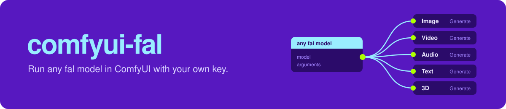
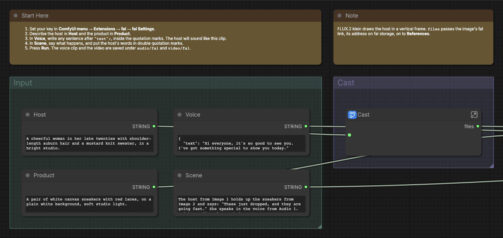

# 

[](#requirements)
[](#requirements)
[](#requirements)
[](LICENSE.md)

Run any fal model in ComfyUI with your own API key.

## Contents

- [Requirements](#requirements)
- [Install](#install)
- [First run](#first-run)
- [Example workflows](#example-workflows)
- [Nodes](#nodes)
- [Models](#models)
- [How a run works](#how-a-run-works)
- [Development](#development)
- [Common problems](#common-problems)
- [License](#license)

## Requirements

- Python 3.12 or later.
- ComfyUI 0.37.2 or later, with frontend 1.52.7 or a later version below 2.0.
- A fal API key.

## Install

Put the extension in `ComfyUI/custom_nodes/fal-ai`, install its
`requirements.txt` with ComfyUI's Python, and restart ComfyUI.

### Comfy Desktop

1. In the instance chooser, select the **⋮** icon on the instance card, then
   **Manage**.
2. Under **About**, copy **Location**. In that folder, find the `ComfyUI` folder
   that holds `main.py`, and put the extension in its `custom_nodes` folder.
3. Select **Terminal** in the same panel and run:

```sh title="In the ComfyUI folder"
pip install -r custom_nodes/fal-ai/requirements.txt
```

### macOS or Linux

From the ComfyUI folder:

```sh title="In the ComfyUI folder"
.venv/bin/python -m pip install -r custom_nodes/fal-ai/requirements.txt
```

With uv:

```sh title="In the ComfyUI folder"
uv pip install --python .venv/bin/python -r custom_nodes/fal-ai/requirements.txt
```

### Windows

From the ComfyUI folder, in PowerShell:

```powershell
.\.venv\Scripts\python.exe -m pip install -r .\custom_nodes\fal-ai\requirements.txt
```

### Windows portable

From the folder that holds `ComfyUI` and `python_embeded`, in PowerShell:

```powershell
.\python_embeded\python.exe -m pip install -r .\ComfyUI\custom_nodes\fal-ai\requirements.txt
```

To update or remove the extension, see the
[advanced guide](ADVANCED.md#update-or-remove).

## First run

1. Open the ComfyUI menu, select **Extensions**, then **fal**, then **fal
   Settings**, and save your fal API key.
2. Open **Browse Templates**, then **fal-ai**, then
   **image-01-design-a-host**, and select **Run**.
3. See your host in **Design**, then the same host from another angle in
   **Turn**.

To send the same request again, change `run_number`.

## Example workflows

| Workflow                                                                                          | Input                         |
| ------------------------------------------------------------------------------------------------- | ----------------------------- |
| [Image: Design a Host](example_workflows/image-01-design-a-host.json)                             | A host description            |
| [Image: Cut Out a Product](example_workflows/image-02-cut-out-a-product.json)                     | A product description         |
| [Image: Make a Poster Series](example_workflows/image-03-make-a-poster-series.json)               | A brief                       |
| [Audio: Voice a Script](example_workflows/audio-01-voice-a-script.json)                           | A script and a sound          |
| [Audio: Split a Song into Stems](example_workflows/audio-02-split-a-song-into-stems.json)         | A song description            |
| [Video: Animate a Host](example_workflows/video-01-animate-a-host.json)                           | A host and a scene            |
| [Video: Give a Host a Voice](example_workflows/video-02-give-a-host-a-voice.json)                 | A host, a product, and a line |
| [Video: Make a Talking Avatar](example_workflows/video-03-make-a-talking-avatar.json)             | A person and a line to say    |
| [Video: Upscale a Clip](example_workflows/video-04-upscale-a-clip.json)                           | A shot                        |
| [Video: Recover a Video](example_workflows/video-05-recover-a-video.json)                         | A request left running        |
| [Text: Transcribe a Voice Note](example_workflows/text-01-transcribe-a-voice-note.json)           | A voice note                  |
| [Text: Describe a Product Photo](example_workflows/text-02-describe-a-product-photo.json)         | A product description         |
| [3D: Turn a Product into a 3D Model](example_workflows/3d-01-turn-a-product-into-a-3d-model.json) | A product description         |

They are in **Browse Templates**, under **fal-ai**. Start with each workflow's
**Start Here** note. Most steps are subgraphs. Media inputs start empty, and
most workflows make their own inputs with fal models.



After an update, open the examples in a new tab to get the new versions.

## Nodes

The nodes are under **fal** in the node menu, and each has a help page.


| Node                                                | What it does                                                                         | Paid |
| --------------------------------------------------- | ------------------------------------------------------------------------------------ | ---- |
| [Image: Generate](web/docs/FalImageGenerate.md)     | Makes, edits, upscales, or cuts out images with any fal image model.                 | Yes  |
| [Video: Generate](web/docs/FalVideoGenerate.md)     | Makes, extends, upscales, or lip-syncs video with any fal video model.               | Yes  |
| [Audio: Generate](web/docs/FalAudioGenerate.md)     | Makes voices, music, and sound effects, or changes audio, with any fal audio model.  | Yes  |
| [Text: Generate](web/docs/FalTextGenerate.md)       | Transcribes speech, or describes images and video, with any fal text model.          | Yes  |
| [3D: Generate](web/docs/FalMeshGenerate.md)         | Makes a 3D model from images or a prompt with any fal 3D model.                      | Yes  |
| [File: Add](web/docs/FalFileAdd.md)                 | Sends a link, image, mask, audio, or video to a model's file input, by its fal name. | No   |
| [Request: Download](web/docs/FalRequestDownload.md) | Downloads the outputs of a request fal kept running after a run stopped.             | No   |
| [Request Options](web/docs/FalRequestOptions.md)    | Sets fal's request options, such as queue priority and retries, for paid nodes.      | No   |
| [Model: Info](web/docs/FalModelInfo.md)             | Shows every setting a fal model takes and what it makes, as JSON.                    | No   |

## Models

Each paid node runs any fal model of its kind. Type the model ID in `model`:
the model's name on fal, such as `alibaba/wan-3.0/reference-to-video`.
[fal's model gallery](https://fal.ai/explore) shows it on each model's page,
with the settings the model takes.


Each kind node has its own inputs for the settings most models of the kind
share, such as `aspect_ratio`, `seed`, and `num_images`. At `default`, a
setting sends nothing, and at `custom`, it sends the value you set. Write the
model's other settings in `arguments` as JSON, under fal's names, such as
`{"enable_safety_checker": false}`. Settings you leave out keep fal's defaults.
**Model: Info** lists every setting a model takes; it bills nothing and needs no
key.

Before fal bills anything, the node reads the model
from fal. The node stops if fal has no such model, the model makes another
kind of output, or the model does not take a setting you sent. The
[advanced guide](ADVANCED.md#models) lists the checks.

## How a run works

1. The node reads the model from fal and checks your inputs against it. When
   a check fails, the node stops before fal bills anything.
2. The node uploads your images, audio, and video to fal, sends one request
   with your key, records it, and waits. The node sends each request only
   once.
3. Outputs also carry fal's link to each file, so the next node sends that
   link instead of uploading the file again. ComfyUI skips the nodes connected
   to an empty output.

The [advanced guide](ADVANCED.md#what-each-node-sends) lists what each node
sends and returns.

## Development

Development needs mise. Point the checks at ComfyUI in `.mise.local.toml`:

```toml
[env]
COMFYUI_PATH = "/path/to/ComfyUI"
COMFYUI_PYTHON = "/path/to/ComfyUI/.venv/bin/python"
```

Install the tools, dependencies, gspot, and the Git hooks, and run every
check:

```shell
mise trust
mise run setup
bun run --no-install gspot check
```

The Git hooks run the checks on each commit and push. Restart ComfyUI after
changing Python. After changing the browser code, run `bun run build`; after
changing a workflow description, run `mise run comfy:workflows:build`. The
[advanced guide](ADVANCED.md#development) lists every check.

## Common problems

| Problem                               | Fix                                                                                                                        |
| ------------------------------------- | -------------------------------------------------------------------------------------------------------------------------- |
| No fal nodes in the menu              | Check that the folder is `ComfyUI/custom_nodes/fal-ai`, ComfyUI is 0.37.2 or later, and the console shows no import error. |
| No **fal** entry under **Extensions** | Check that `web/extension.js` exists in the extension's folder, then reload the window.                                    |
| The settings cannot be changed        | ComfyUI runs in multi-user mode or is open from another computer. Set `FAL_KEY` where ComfyUI starts instead.              |
| `pydantic` cannot be imported         | Install `requirements.txt` with the Python that runs ComfyUI, then restart.                                                |
| Node help is missing                  | Reinstall the whole extension, including `web/docs`.                                                                       |
| The templates are missing             | Reinstall the whole extension, including `example_workflows`.                                                              |
| Nodes or menus appear twice           | Keep one `fal-ai` folder in `custom_nodes`; move copies elsewhere.                                                         |

More in the [advanced guide's troubleshooting](ADVANCED.md#troubleshooting).

## License

[MIT](LICENSE.md).
