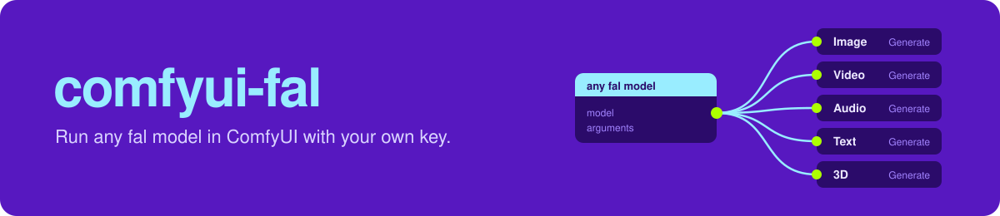

# 

[](#requirements)
[](#requirements)
[](#requirements)
[](LICENSE.md)

Run fal models in ComfyUI with your own API key: images, video, audio, text, and 3D.

## Requirements

- Python 3.12 or later.
- ComfyUI 0.37.2 or later, with frontend 1.52.7 or a later version below 2.0.
- A fal API key.

Generation uses your provider account and can incur charges.

## Install

Stop ComfyUI. From its `custom_nodes` folder, clone the extension:

```sh
git clone https://github.com/stefanionescu/comfyui-fal.git fal-ai
```

In Comfy Desktop, use **Manage > About > Location** to find the installation's
`ComfyUI` folder. Its **Terminal** opens that instance's Python environment.

Install runtime dependencies with the Python that runs ComfyUI.
Choose the command for your installation:

**Comfy Desktop**, in its Terminal:

```sh title="Comfy Desktop terminal, in the ComfyUI folder"
pip install -r custom_nodes/fal-ai/requirements.txt
```

**macOS or Linux**, from the ComfyUI folder:

```sh title="In the ComfyUI folder"
.venv/bin/python -m pip install -r custom_nodes/fal-ai/requirements.txt
```

**Windows**, in PowerShell from the ComfyUI folder:

```powershell title="In the ComfyUI folder"
.\.venv\Scripts\python.exe -m pip install -r .\custom_nodes\fal-ai\requirements.txt
```

**Windows portable**, in PowerShell from the folder containing ComfyUI:

```powershell title="Windows portable parent folder"
.\python_embeded\python.exe -m pip install -r .\ComfyUI\custom_nodes\fal-ai\requirements.txt
```

Replace `.venv` if your environment has another name. Restart ComfyUI and
reload its window.

## First run

1. Open **Extensions > fal > fal Settings** from the ComfyUI menu and save
   your complete fal API key. Include both parts and the colon.
2. Open **Browse Templates > fal-ai > image-01-design-a-host**.
   Read **Start Here** and edit the description.
3. Select **Run**. **Design** creates the portrait; **Turn** edits it.
   This example sends two paid image requests.

Cancelling asks fal to cancel the request. A request that has started can still
finish and incur charges. Use **Request: Download** to collect its outputs.

Change `run_number` to run again with unchanged inputs. For remote or multi-user
setups, see the [access instructions](ADVANCED.md#keys-and-access).

## Example workflows

Open these from **Browse Templates > fal-ai**, or load their JSON files.
Read **Start Here** before running. After an update, open examples in a new tab.

| Workflow                                                                                          | Input                         |
| ------------------------------------------------------------------------------------------------- | ----------------------------- |
| [Image: Design a Host](example_workflows/image-01-design-a-host.json)                             | A host description            |
| [Image: Cut Out a Product](example_workflows/image-02-cut-out-a-product.json)                     | A product description         |
| [Image: Make a Poster Series](example_workflows/image-03-make-a-poster-series.json)               | A brief                       |
| [Audio: Voice a Script](example_workflows/audio-01-voice-a-script.json)                           | A script and a sound          |
| [Audio: Split a Song into Stems](example_workflows/audio-02-split-a-song-into-stems.json)         | A song description            |
| [Video: Animate a Host](example_workflows/video-01-animate-a-host.json)                           | A host and a scene            |
| [Video: Give a Host a Voice](example_workflows/video-02-give-a-host-a-voice.json)                 | A host, a product, and a line |
| [Video: Make a Talking Avatar](example_workflows/video-03-make-a-talking-avatar.json)             | A person and a line to say    |
| [Video: Upscale a Clip](example_workflows/video-04-upscale-a-clip.json)                           | A shot                        |
| [Video: Recover a Video](example_workflows/video-05-recover-a-video.json)                         | A request left running        |
| [Text: Transcribe a Voice Note](example_workflows/text-01-transcribe-a-voice-note.json)           | A voice note                  |
| [Text: Describe a Product Photo](example_workflows/text-02-describe-a-product-photo.json)         | A product description         |
| [3D: Turn a Product into a 3D Model](example_workflows/3d-01-turn-a-product-into-a-3d-model.json) | A product description         |

## Nodes

Find the nodes under **fal**. Each linked help page explains its inputs,
outputs, and usage.

| Node                                                | What it does                                                                                | Paid |
| --------------------------------------------------- | ------------------------------------------------------------------------------------------- | ---- |
| [Image: Generate](web/docs/FalImageGenerate.md)     | Makes, edits, upscales, or cuts out images with a supported fal image model.                | Yes  |
| [Video: Generate](web/docs/FalVideoGenerate.md)     | Makes, extends, upscales, or lip-syncs video with a supported fal video model.              | Yes  |
| [Audio: Generate](web/docs/FalAudioGenerate.md)     | Makes voices, music, and sound effects, or changes audio, with a supported fal audio model. | Yes  |
| [Text: Generate](web/docs/FalTextGenerate.md)       | Transcribes speech, or describes images and video, with a supported fal text model.         | Yes  |
| [3D: Generate](web/docs/FalMeshGenerate.md)         | Makes a 3D model from images or a prompt with a supported fal 3D model.                     | Yes  |
| [File: Add](web/docs/FalFileAdd.md)                 | Sends a link, image, mask, audio, or video to a model's file input, by its fal name.        | No   |
| [Request: Download](web/docs/FalRequestDownload.md) | Downloads the outputs of a request fal kept running after a run stopped.                    | No   |
| [Request Options](web/docs/FalRequestOptions.md)    | Sets fal's request options, such as queue priority and retries, for paid nodes.             | No   |
| [Model: Info](web/docs/FalModelInfo.md)             | Shows every setting a fal model takes and what it makes, as JSON.                           | No   |

Use the ID from [fal's model gallery](https://fal.ai/explore) in `model`.
Choose the node for the model's output: an upscaler uses **Image: Generate**;
a transcription model uses **Text: Generate**. Training and realtime models
are not supported. **Model: Info** lists the model's inputs and defaults.
See [models and arguments](ADVANCED.md#models).

## Troubleshooting

| Problem                        | What to check                                                                            |
| ------------------------------ | ---------------------------------------------------------------------------------------- |
| Nodes or templates are missing | Install the complete extension and its requirements with ComfyUI's Python, then restart. |
| The key is rejected            | Paste both parts and the colon; check whether `FAL_KEY` overrides the saved key.         |
| A model or input is rejected   | Copy its exact ID and inspect its schema with **Model: Info**.                           |
| A request outlives ComfyUI     | Collect it with **Request: Download** before its result expires.                         |
| Settings cannot be changed     | Use a direct local connection, or configure credentials on the ComfyUI server.           |

See the [advanced guide](ADVANCED.md#troubleshooting) for request errors and recovery.

[Advanced guide](ADVANCED.md) · [MIT license](LICENSE.md)
